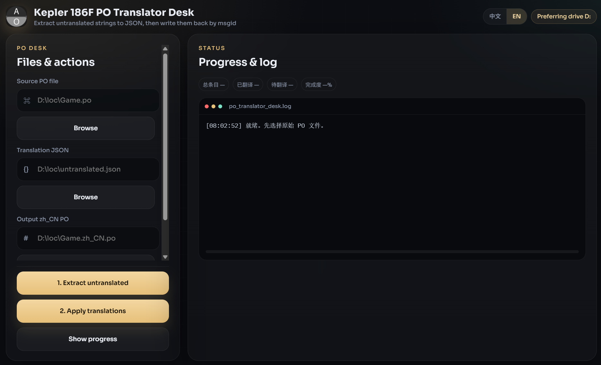

<div align="center">

# Kepler 186F PO Translator Desk

**Packed via Axiox Media**

Desktop helper that extracts untranslated gettext `.po` strings to JSON and writes translations back by `msgid`, so entries cannot land on the wrong line.

<p>
  <a href="docs/README-zh.md"></a>
</p>

<p>
  <a href="#install">Install</a> ·
  <a href="#features">Features</a> ·
  <a href="#requirements">Requirements</a> ·
  <a href="#architecture">Architecture</a> ·
  <a href="#documentation">FAQ</a>
</p>

<p>
  
  
  
  
</p>

</div>

<div align="center">
  
</div>

> [!WARNING]
> The PyInstaller EXE is unsigned. Windows SmartScreen may warn on first launch. The tool never overwrites the source `.po`; pick a new output path.

---

<a id="install"></a>

## Install

### 1. GitHub Deploy Desk (recommended)

One-click deploy this repository with [GitHub Deploy Desk](https://github.com/axioxmedia/github-deployer).

1. Get the deployer: https://github.com/axioxmedia/github-deployer
2. Paste this repo URL into Deploy Desk: https://github.com/axioxmedia/PO_Translator_Assistant_GUI
3. Read the README in the app, then confirm deploy.

That is the supported install path. Use the source / EXE steps below only if you are already building from a local checkout.

### 2. Run from source or freeze an EXE

| Platform | Package | Guide |
|---|---|---|
| Windows 10/11 | `dist\PoTranslatorDesk.exe` | Python 3.11+ on PATH, close any running EXE, then `build_exe.bat` |
| Development | Run from source | `python app.py` or `python app.py --web` |

```bash
git clone https://github.com/axioxmedia/PO_Translator_Assistant_GUI.git
cd PO_Translator_Assistant_GUI
python -m venv .venv
.venv\Scripts\activate
pip install -r requirements.txt
python app.py
```

`python app.py --web` serves only the local UI at `http://127.0.0.1:8787`.

```bat
build_exe.bat
```

Or:

```powershell
powershell -ExecutionPolicy Bypass -File .\build_exe.ps1
```

Output: `dist\PoTranslatorDesk.exe`. If the window fails to start, send `dist\po_translator_desk.log`.

<a id="features"></a>

## Features

| Area | Included |
|---|---|
| **Extract** | Writes untranslated rows (`msgstr` empty or equal to `msgid`) to a JSON array |
| **Apply by msgid** | Dictionary match on `msgid` only — no index / order apply |
| **Safe output** | Writes a new `.po`; refuses to overwrite the source file |
| **Progress** | Total / done / pending / percent plus a local log pane |
| **Header pass** | Sets `Language: zh_CN` and refreshes `PO-Revision-Date` after apply |
| **Desktop UI** | Dark glass layout, zh/en switch, native file dialogs |
| **Local only** | Binds `127.0.0.1`; no cloud translation API |

### Workflow

1. Pick the source `.po`.
2. **Extract untranslated** → save `untranslated.json`.
3. Fill `msgstr` in that JSON with an editor or an AI chat. Keep the array shape.
4. **Apply translations** → write `{stem}.zh_CN.po`.
5. **Show progress** on the source or the output file.

JSON shape:

```json
[
  {
    "id": 1,
    "msgid": "Welcome to our platform",
    "msgstr": "欢迎来到我们的平台"
  }
]
```

Rows with an empty `msgstr` are skipped on apply.

<a id="requirements"></a>

## Requirements

| | Minimum | Recommended |
|---|---|---|
| **OS** | Windows 10 x64 for the EXE | Windows 11 |
| **RAM** | 4 GB | 8 GB |
| **Disk** | 200 MB for the app | SSD |
| **Python from source** | 3.11+ | 3.12 |

WebView2 ships with current Windows 10/11. No GPU and no third-party translation key are required.

<a id="architecture"></a>

## Architecture

```text
pywebview desktop window
        │ HTTP on 127.0.0.1
FastAPI + uvicorn
        ├── GET  /api/defaults
        ├── POST /api/pick
        ├── POST /api/inspect
        ├── POST /api/extract
        └── POST /api/apply
static HTML / CSS / JS
axioxmedia.py                      (packer watermark + OS title)
```

| Layer | Path | Responsibility |
|---|---|---|
| Window | `app.py` `run_desktop()` | Port pick, uvicorn thread, pywebview, dark title bar |
| Brand | `axioxmedia.py` | OS-language window title and packer mark |
| API | `app.py` | PO parse, JSON extract, msgid apply |
| UI | `static/` | i18n, paths, stats, log |
| Pack | `PoTranslatorDesk.spec` | Onefile EXE with `static/` bundled |

The windowed EXE has no console. `ensure_stdio()` and `log_config=None` keep uvicorn from crashing when `sys.stderr` is `None`.

This desk-app keeps the v1.3 Tkinter match rules: single-line `msgid` / `msgstr` blocks and `msgid` dictionary apply.

<a id="documentation"></a>

## Documentation

<details>
<summary><strong>Why is the window title prefixed with Axiox Media?</strong></summary>

The packaged build stamps the OS-language packer line:

- Chinese UI — `由安溯媒体自动打包，软件名：凯普勒 186F PO 翻译助手`
- Any other UI — `Packed via Axiox Media, software name: Kepler 186F PO Translator Desk`

The in-app heading stays as the short product name.

</details>

<details>
<summary><strong>Does this call ChatGPT / Gemini / Google Translate?</strong></summary>

No. Extract produces JSON you can paste into any model. Apply only reads the JSON you give it.

</details>

<details>
<summary><strong>What if my .po uses multiline msgid blocks?</strong></summary>

The parser matches the same single-line `msgid "…" / msgstr "…"` pattern as the original Tkinter tool. Split multiline entries before extract, or keep them as already-translated.

</details>

<details>
<summary><strong>Can I expose this on my LAN?</strong></summary>

The server binds loopback only. Do not republish port 8787 without adding your own auth.

</details>

## License

MIT. See [LICENSE](LICENSE).

Packed via Axiox Media · [axiox.media](https://axiox.media)
