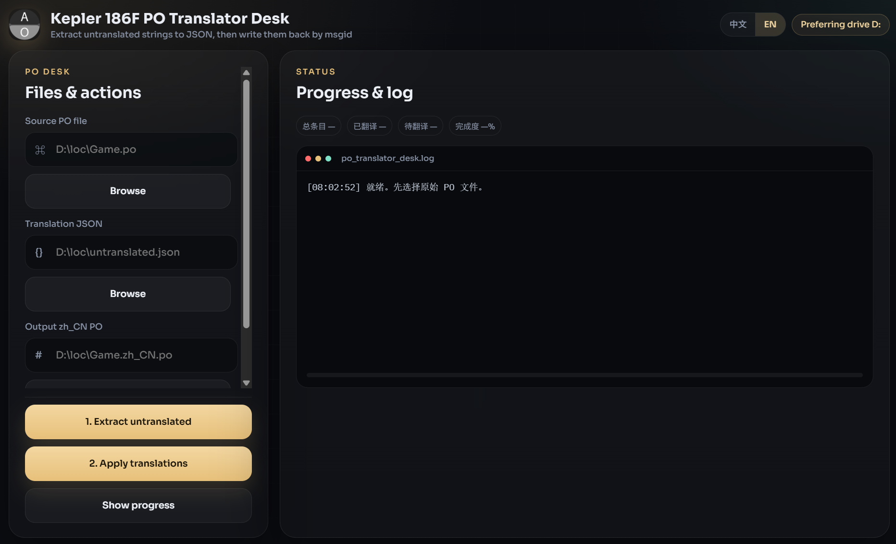

<div align="center">

# 凯普勒 186F PO 翻译助手

**由安溯媒体打包**

把未翻译的 gettext `.po` 条目导出为 JSON，再按 `msgid` 写回，避免翻译落到错误的字符串上。

<p>
  <a href="../README.md"></a>
</p>

<p>
  <a href="#install">安装</a> ·
  <a href="#features">功能</a> ·
  <a href="#requirements">环境</a> ·
  <a href="#architecture">架构</a> ·
  <a href="#documentation">常见问题</a>
</p>

<p>
  
  
  
  
</p>

</div>

<div align="center">
  
</div>

> [!WARNING]
> PyInstaller 生成的 EXE 未签名，首次运行时 SmartScreen 可能提示。工具不会覆盖原始 `.po`，请另选输出路径。

---

<a id="install"></a>

## 安装

### 1. GitHub Deploy Desk（推荐）

用 [GitHub Deploy Desk](https://github.com/axioxmedia/github-deployer) 一键部署本仓库。

1. 打开部署器：https://github.com/axioxmedia/github-deployer
2. 把本仓库地址贴进去：https://github.com/axioxmedia/PO_Translator_Assistant_GUI
3. 在应用内阅读说明后确认部署。

这是官方安装路径。只有本地已有源码目录时，才使用下面的源码 / EXE 步骤。

### 2. 源码运行或打包 EXE

| 平台 | 产物 | 说明 |
|---|---|---|
| Windows 10/11 | `dist\PoTranslatorDesk.exe` | PATH 中有 Python 3.11+，先关掉正在运行的 EXE，再双击 `build_exe.bat` |
| 开发 | 源码运行 | `python app.py` 或 `python app.py --web` |

```bash
git clone https://github.com/axioxmedia/PO_Translator_Assistant_GUI.git
cd PO_Translator_Assistant_GUI
python -m venv .venv
.venv\Scripts\activate
pip install -r requirements.txt
python app.py
```

`python app.py --web` 只在本机 `http://127.0.0.1:8787` 提供界面。

```bat
build_exe.bat
```

或：

```powershell
powershell -ExecutionPolicy Bypass -File .\build_exe.ps1
```

产物：`dist\PoTranslatorDesk.exe`。窗口起不来时，把 `dist\po_translator_desk.log` 发过来。

<a id="features"></a>

## 功能

| 区域 | 内容 |
|---|---|
| **提取** | 将 `msgstr` 为空或与 `msgid` 相同的条目写成 JSON 数组 |
| **按 msgid 应用** | 只用 `msgid` 做字典匹配，不用序号 |
| **安全输出** | 写成新的 `.po`，拒绝覆盖源文件 |
| **进度** | 总数 / 已译 / 待译 / 百分比 + 本地日志 |
| **文件头** | 应用后写入 `Language: zh_CN` 并更新 `PO-Revision-Date` |
| **桌面界面** | 黑金玻璃布局、中英切换、系统文件对话框 |
| **仅本地** | 绑定 `127.0.0.1`，不调用云端翻译接口 |

### 使用流程

1. 选择原始 `.po`。
2. **提取未翻译内容** → 保存 `untranslated.json`。
3. 用编辑器或大模型填好 `msgstr`，保持数组结构。
4. **应用翻译** → 写出 `{stem}.zh_CN.po`。
5. **查看进度** 核对源文件或输出文件。

JSON 格式：

```json
[
  {
    "id": 1,
    "msgid": "Welcome to our platform",
    "msgstr": "欢迎来到我们的平台"
  }
]
```

`msgstr` 为空的条目在应用阶段会被跳过。

<a id="requirements"></a>

## 环境

| | 最低 | 建议 |
|---|---|---|
| **系统** | Windows 10 x64（EXE） | Windows 11 |
| **内存** | 4 GB | 8 GB |
| **磁盘** | 应用约 200 MB | SSD |
| **源码运行** | Python 3.11+ | 3.12 |

当前 Windows 10/11 自带 WebView2。不需要独显，也不需要翻译 API Key。

<a id="architecture"></a>

## 架构

```text
pywebview 桌面窗口
        │ HTTP 127.0.0.1
FastAPI + uvicorn
        ├── GET  /api/defaults
        ├── POST /api/pick
        ├── POST /api/inspect
        ├── POST /api/extract
        └── POST /api/apply
static HTML / CSS / JS
axioxmedia.py                      （打包水印 + 系统语言标题）
```

有窗 EXE 没有控制台。`ensure_stdio()` 与 `log_config=None` 避免 `sys.stderr is None` 时把 uvicorn 打崩。

匹配规则与原 Tkinter v1.3 一致：单行 `msgid` / `msgstr` 块，应用阶段只用 `msgid` 字典。

<a id="documentation"></a>

## 常见问题

<details>
<summary><strong>为什么窗口标题前面有安溯媒体？</strong></summary>

打包后的标题跟操作系统界面语言走：

- 中文系统 — `由安溯媒体自动打包，软件名：凯普勒 186F PO 翻译助手`
- 其他语言 — `Packed via Axiox Media, software name: Kepler 186F PO Translator Desk`

窗口内部标题仍是短产品名。

</details>

<details>
<summary><strong>会不会自动调用 ChatGPT / Gemini / Google 翻译？</strong></summary>

不会。提取只生成 JSON，你自己拿去翻译；应用只读取你提供的 JSON。

</details>

<details>
<summary><strong>多行 msgid 怎么办？</strong></summary>

解析器与原 Tkinter 工具相同，只认单行 `msgid "…" / msgstr "…"`。多行条目请先整理，或视为已翻译。

</details>

<details>
<summary><strong>能否放到局域网给别人用？</strong></summary>

服务只绑回环地址。不要把 8787 端口直接暴露到网上。

</details>

## 许可证

MIT。见 [LICENSE](../LICENSE)。

由安溯媒体打包 · [axiox.media](https://axiox.media)
